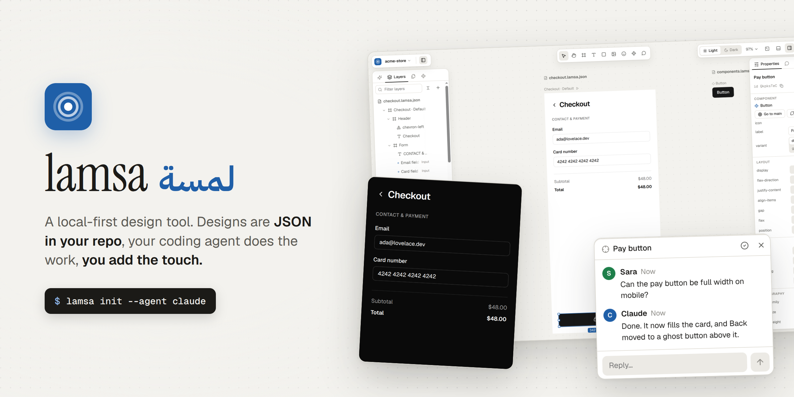
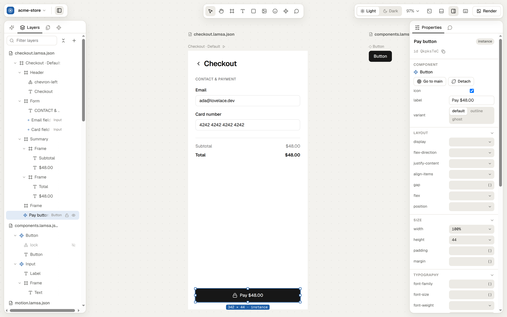
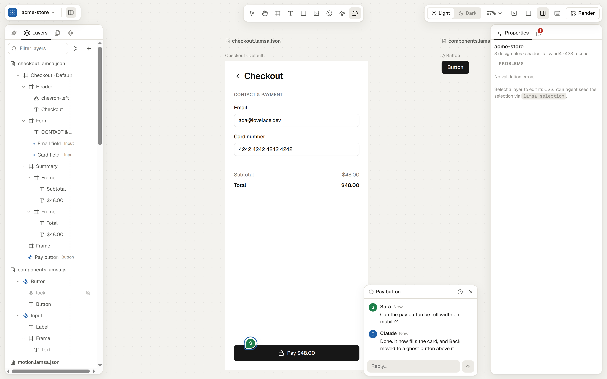
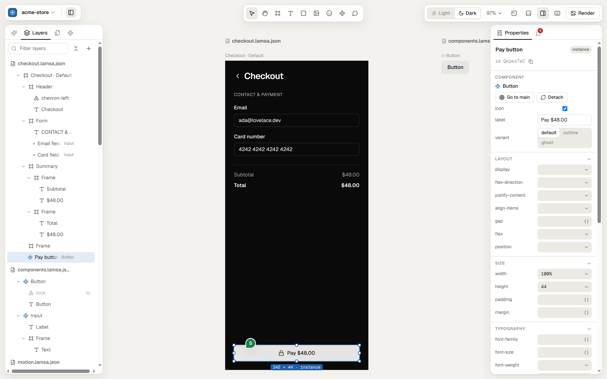
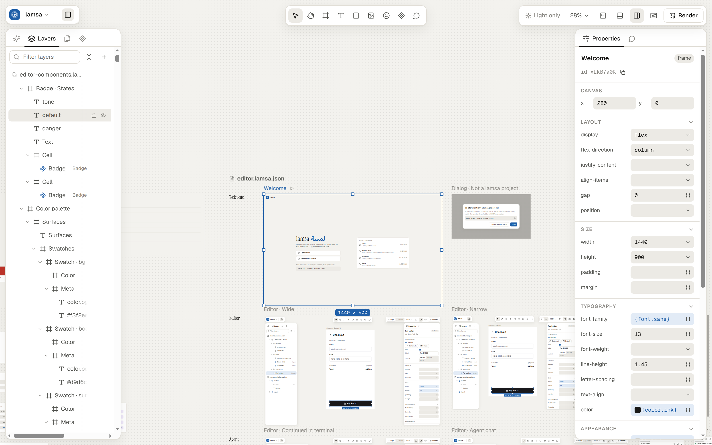

<p align="center"></p>

# lamsa

lamsa (لمسة, "a touch") is an open-source, local-first design tool for developers and design engineers. Designs are plain JSON files in your app's repo, reviewed in pull requests. Your own coding agent does the bulk of the work through the `lamsa` CLI; you add the touch in a desktop editor.

- **Files are the product.** `*.lamsa.json`, a flat node map with a published JSON Schema.
- **The CLI never calls an LLM.** Bring any agent. Nothing is metered, no login.
- **Spec, not codegen.** Your agent reads the design and implements it with your components.
- **Tokens come from your code.** shadcn / Tailwind v4 `globals.css` is read directly.
- **Agent-complete.** Init, design, validate, render and review all run headless.



## Install

The CLI needs Node 22 or later.

```sh
npm i -g @lamsa/cli      # for yourself
pnpm add -D @lamsa/cli   # for a team: pins the version in your repo, so CI and every agent use it
```

`lamsa render` uses your installed Chrome, or downloads Chromium once on first use.

The desktop editor is on the [releases page](https://github.com/Shunseii/lamsa/releases/latest): a `.dmg` for macOS (Apple silicon or Intel), and an `.AppImage` or `.deb` for Linux. `lamsa open` finds it in `/Applications`, as `lamsa-desktop` on your PATH (the `.deb` puts it there), or as an AppImage in `~/Applications`.

```sh
lamsa init --agent claude --yes       # config, agent skill, AGENTS.md section
lamsa tokens                          # what your app's CSS defines
lamsa add --file designs/home.lamsa.json --tree '{"type":"frame","name":"Home","style":{"width":390,"height":844}}'
lamsa validate                        # errors name the node ID and a fix
lamsa render Home                     # PNGs in .lamsa/render/
```

<table>
  <tr>
    <td></td>
    <td></td>
  </tr>
  <tr>
    <td>Comment on any layer; your agent reads and answers them with <code>lamsa comments</code>.</td>
    <td>Preview light and dark straight from your app's tokens.</td>
  </tr>
</table>


<p align="center"><sub>lamsa is designed in lamsa: <code>designs/editor.lamsa.json</code></sub></p>

See [SPEC.md](SPEC.md) for the design and `examples/shadcn-app` for a working project.

## Development

```sh
pnpm install
pnpm build
pnpm test
```

To install the `lamsa` CLI and the desktop editor from this checkout for your user (on Linux: `~/.local/bin`, plus an app-menu entry and icon), run `pnpm --filter @lamsa/desktop install:app`.

MIT licensed.

## Packages

| Path | What |
|---|---|
| `packages/schema` | `@lamsa/schema`: types and the JSON Schema |
| `packages/core` | `@lamsa/core`: load, validate, fmt, edit, diff, token adapters |
| `packages/renderer` | `@lamsa/renderer`: design JSON → DOM/CSS (editor and exports) |
| `packages/cli` | `@lamsa/cli`: the `lamsa` CLI and the agent skill (bundles the packages above when published) |
| `apps/desktop` | Electron editor (`pnpm desktop`, or `lamsa open` with `lamsa-desktop` on PATH / `LAMSA_DESKTOP_BIN`) |
| `action` | GitHub Action for PR previews |

`pnpm test` builds everything and runs unit, CLI and desktop end-to-end tests (the editor runs offscreen, no display needed).

To release, publish a GitHub release with a version tag: `gh release create v0.2.0 --title v0.2.0 --notes "…"`. The release workflow publishes `@lamsa/cli` to npm and attaches signed installers for macOS and Linux. `pnpm --filter @lamsa/desktop dist` builds the installers locally into `apps/desktop/release/`.
