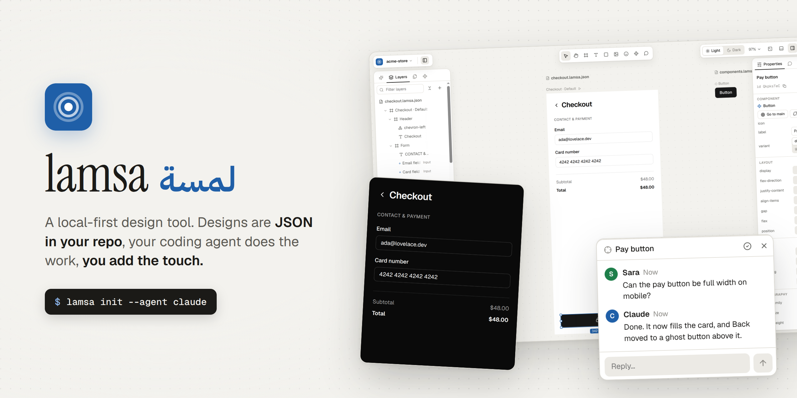

<p align="center"></p>

# lamsa

lamsa (لمسة, "a touch") is an open-source, local-first design tool for developers and design engineers. Designs are plain JSON files in your app's repo, reviewed in pull requests. Your own coding agent does the bulk of the work through this CLI; you add the touch in the desktop editor.

## Install

Needs Node 22 or later.

```sh
npm i -g @lamsa/cli      # for yourself
pnpm add -D @lamsa/cli   # for a team: pins the version in your repo, so CI and every agent use it
```

`lamsa render` uses your installed Chrome, or downloads Chromium once on first use.

## Use

```sh
lamsa init --agent claude --yes       # config, agent skill, AGENTS.md section
lamsa tokens                          # what your app's CSS defines
lamsa add --file designs/home.lamsa.json --tree '{"type":"frame","name":"Home","style":{"width":390,"height":844}}'
lamsa validate                        # errors name the node ID and a fix
lamsa render Home                     # PNGs in .lamsa/render/
lamsa diff main                       # what changed since main, rendered before and after
```

Run `lamsa --help` for every command. See the [repository](https://github.com/Shunseii/lamsa) for the editor, the file format and the spec.

MIT licensed.
